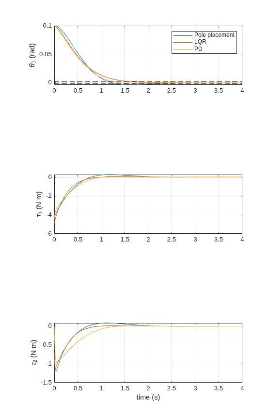
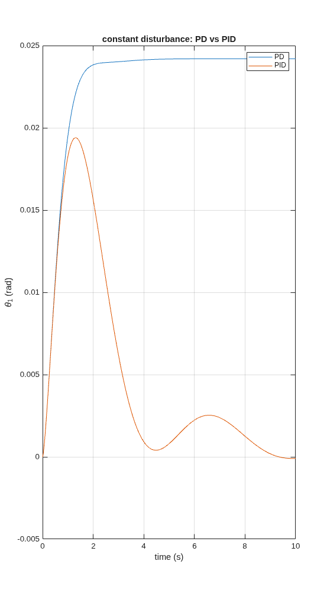
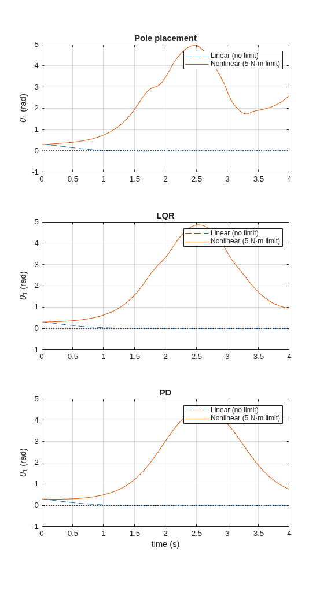
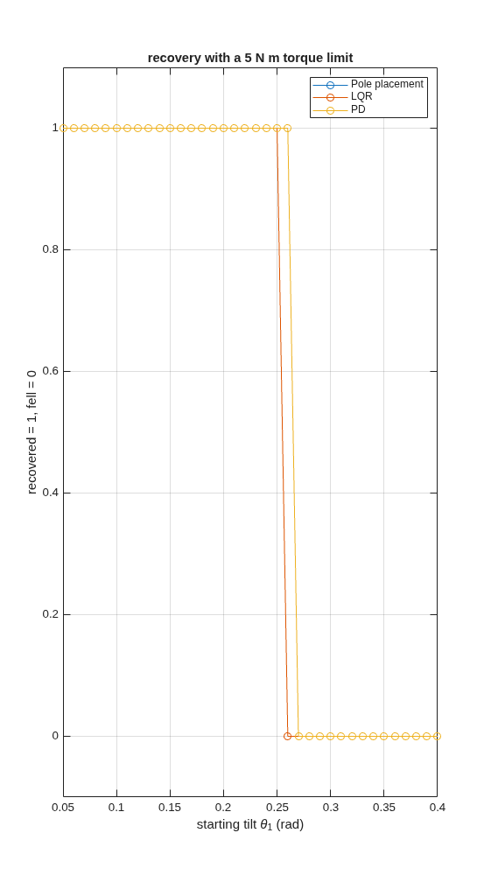

# Two-link arm balance control
Pole placement vs LQR vs PD/PID for a two-link arm in MATLAB (simulation)
Simulation of an upright two-link arm (inverted double pendulum, motor at each joint). I compared pole placement, LQR and joint-wise PD, then tested what happens when the motors are limited to 5 N·m.

## Model
- Two uniform rods, m = 1 kg and L = 1 m each, balanced upright
- States: both joint angles and velocities (deviations from upright)
- Equations of motion derived with the Lagrangian method (L = kinetic energy minus potential energy), then linearized about the upright pose for controller design
- The full nonlinear model is used for testing, and I checked that its linearization matches the linear model (max difference about 6e-9)

## Controllers
- Pole placement: poles at -2±1.95j, -6, -7
- LQR: Q = diag(100, 100, 4, 4), R = 0.2 I
- PD: Kp = 45 and 10, Kd = 10 and 4 (each joint uses its own angle and velocity)
- PID demo: integral gains 10 and 5 added to the PD

## Results (linear model, 0.1 rad starting tilt)
| Controller | Settling time (s) | Overshoot (%) | Peak torque (N·m) |

| Controller | Settling time (s) | Overshoot (%) | Peak torque (N·m) |
|---|---|---|---|
| Pole placement | 2.12 | 3.98 | 4.21 |
| LQR | 1.59 | 0.01 | 4.97 |
| PD | 1.25 | 1.74 | 4.50 |

A constant 0.5 N·m disturbance on joint 1 leaves PD with an offset of 0.0242 rad. PID brings it back to about 0 (-0.0001 rad).

## Torque limit (nonlinear model)
At a 0.3 rad tilt the linear designs ask for 12.6 to 14.9 N·m. With the motors limited to 5 N·m, all three controllers fail to recover.

Sweeping the starting tilt, the largest tilt each controller recovers from is:
- Pole placement: 0.25 rad (14.3 deg)
- LQR: 0.25 rad (14.3 deg)
- PD: 0.26 rad (14.9 deg)

The differences are one step of the sweep (0.01 rad), so I would call them about equal. Recovery means both joint angles are under 0.01 rad after 6 s. In the plot, pole placement and LQR overlap.

## Limitations
- Simulation only
- Full state is measured perfectly, with no noise, delay or friction
- The PD design has a fast closed-loop pole (about -67), which would be hard to realize with real sensors

## How to run
Needs MATLAB with the Control System Toolbox.
1. `scripts/linear_comparison.m`: model, controllers, comparison plots, PID demo
2. `scripts/nonlinear_test.m`: nonlinear simulation with the torque limit
3. `scripts/tilt_sweep.m`: largest recoverable tilt

## Figures

